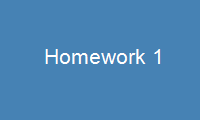

```python
import zipfile, os

# Find the uploaded zip file in /mnt/data
files = os.listdir('/mnt/data')
print("Files in /mnt/data:", files)

zip_files = [f for f in files if f.endswith('.zip')]
for zf in zip_files:
    path = os.path.join('/mnt/data', zf)
    with zipfile.ZipFile(path, 'r') as z:
        print("Archive contents:", z.namelist())
        for name in z.namelist():
            if not name.endswith('/') and not name.endswith('.png'):
                print(f"\n--- {name} ---")
                print(z.read(name).decode('utf-8', errors='replace'))


```

```text
Files in /mnt/data: ['Homework-1-main.zip', 'flixo_escrow-main.7z', 'บทของทุน27_09_26q.pdf']
Archive contents: ['Homework-1-main/', 'Homework-1-main/image.png', 'Homework-1-main/index.html', 'Homework-1-main/script.js', 'Homework-1-main/style.css']

--- Homework-1-main/index.html ---
<!DOCTYPE html>
<html lang="en">
<head>
  <meta charset="UTF-8">
  <meta name="viewport" content="width=device-width, initial-scale=1.0">
  <title>Homework 1</title>
  <link rel="stylesheet" href="style.css">
</head>
<body>
  <main>
    <h1>Homework 1</h1>
    <p>Simple starter page.</p>
    
  </main>
  <script src="script.js"></script>
</body>
</html>


--- Homework-1-main/script.js ---
console.log("Homework 1 loaded");


--- Homework-1-main/style.css ---
* {
  box-sizing: border-box;
}

body {
  margin: 0;
  font-family: Georgia, "Times New Roman", serif;
  background: #f7f7f7;
  color: #222;
}

main {
  max-width: 40rem;
  margin: 3rem auto;
  padding: 0 1.25rem;
}

h1 {
  margin-bottom: 0.5rem;
}

img {
  display: block;
  margin-top: 1.5rem;
  max-width: 100%;
  height: auto;
}


```

```markdown
# Homework 1

โปรเจกต์เว็บเบื้องต้น (Simple Starter Page) พัฒนาด้วย HTML5, CSS3 และ Vanilla JavaScript

## 📁 โครงสร้างโปรเจกต์ (Project Structure)

```text
Homework-1-main/
├── index.html      # โครงสร้างหลักของหน้าเว็บ
├── style.css       # การจัดรูปแบบและตกแต่งหน้าเว็บ
├── script.js       # สคริปต์การทำงานฝั่ง Client (JavaScript)
└── image.png       # รูปภาพประกอบในหน้าเว็บ

```

## ✨ รายละเอียดการทำงาน (Features)

* **HTML (`index.html`):** แสดงหัวข้อหลัก (`Homework 1`), ข้อความอธิบายเบื้องต้น (`Simple starter page.`) และแสดงผลรูปภาพ `image.png`
* **CSS (`style.css`):** จัดวางเลย์เอาต์ให้อยู่กึ่งกลางหน้าจอ (ความกว้างสูงสุด `40rem`) ใช้ฟอนต์ตระกูล Serif (`Georgia`) และรองรับการแสดงผลรูปภาพแบบ Responsive (`max-width: 100%`)
* **JavaScript (`script.js`):** แสดงข้อความแจ้งเตือนสถานะการโหลดหน้าเว็บใน Console (`Homework 1 loaded`)

## 🚀 วิธีใช้งาน (Getting Started)

1. ดาวน์โหลดหรือแตกไฟล์โปรเจกต์ `Homework-1-main`
2. เปิดไฟล์ `index.html` ด้วยเว็บเบราว์เซอร์ (เช่น Google Chrome, Microsoft Edge หรือ Firefox) หรือใช้งานผ่าน Live Server ใน VS Code
3. เปิด Developer Tools (`F12` หรือคลิกขวาเลือก **Inspect** $\rightarrow$ **Console**) เพื่อตรวจสอบการทำงานของไฟล์ `script.js`

